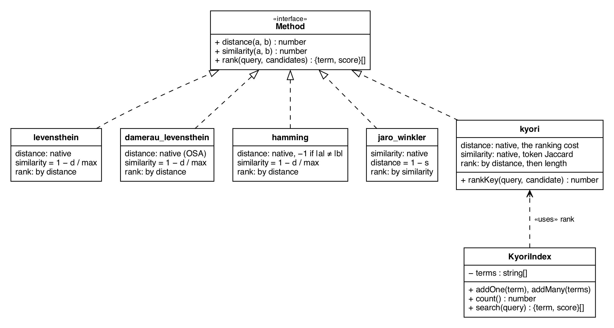

# Summary

Kyori is a JavaScript library for comparing strings. It implements the
classic edit distances of Levenshtein, Damerau–Levenshtein and Hamming and
the Jaro–Winkler similarity, and adds a method of its own, also called Kyori, for putting an
autocomplete list in order. When a user types into a search box, the
application keeps the entries that begin with the typed text and must
decide which to show first. Kyori's
method scores each candidate against the typed text with four ordered rules
over folded strings; it tolerates typing errors from the third typed character on,
charges one point when the same words appear in another order, and breaks
ties by length, shorter completions first. Every method exposes the same
three functions, `similarity`, `distance` and `rank`. The library
is published on npm as `@wizhut_tech/kyori` under the MIT licence,
runs on Node.js 14.13 or later with one runtime dependency, and ships
with 404 test assertions.

# Statement of need

Three tasks share the vocabulary of closeness and are not the same task.
Record linkage asks how much two names or titles resemble each other
[@fellegi1969]; spelling correction asks how many edits
separate a mistyped word from the intended one [@damerau1964]; query
auto-completion (QAC) asks in what order a list of completions should
appear once the typed prefix has selected them [@baryossef2011].
Levenshtein counted insertions, deletions and
substitutions [@levenshtein1966] and Damerau added the adjacent
transposition [@damerau1964]; Jaro and Winkler rewarded agreeing characters
and a shared prefix [@jaro1989; @winkler1990]; Jaccard's index compared
sets of words [@jaccard1912]; and Cohen, Ravikumar and Fienberg compared
the family by how well each ranks the true match among candidates
[@cohen2003], the protocol Kyori's evaluation adopts. Autocompletion added
the most popular completion over a prefix tree [@baryossef2011] and error
tolerance through the edit distance between the typed text and a prefix of
each completion [@chaudhuri2009], shipped by Lucene as a fuzzy suggester [@lucene3846].

A JavaScript application that must order a filtered list chooses among
libraries that each answer with one scalar meant for a different job: a
pairwise similarity, an edit distance, or a typeahead score with one fixed
policy and no published measurement of the order it produces. Application
developers get the classic measures behind one contract and a ranking cost built for the order-after-filter step; researchers get a method whose
every rule is traced to its precedent, and an evaluation tree
that measures it, eleven alternatives and two ablations with the metrics
QAC uses for ordering [@kyoriresearch].

# State of the field

The turn to learned models has reached string comparison: entity matching
is learned from the Magellan suites by neural models [@mudgal2018], and
query auto-completion is generative, AmazonQAC a benchmark for language
models [@everaert2024]; exact edit distance admits no strongly
subquadratic algorithm unless the strong exponential time hypothesis fails
[@backurs2015]. A deterministic method offers what a model does not: no
training data, no parameters, an order a rule can explain. Applications
still ship such measures. In JavaScript, Talisman [@plique2020], natural [@natural] and
fastest-levenshtein [@fastestlevenshtein] return a pairwise score and say
nothing about ordering a list. The typeahead libraries order lists, each by one policy: Fuse.js [@fusejs] weights a Bitap match [@baezayates1992] by its
location and the field's length; fuzzysort
[@fuzzysort] scores a subsequence match less the candidate's length;
match-sorter [@matchsorter] sorts by tier, each tier alphabetical.
Outside JavaScript the division holds: RapidFuzz [@rapidfuzz] and
stringdist [@vanderloo2014] are metric collections; pg_trgm [@pgtrgm] and the Lucene and Elasticsearch suggesters rank inside a
search engine. The hosted engines Algolia [@algolia2026], Meilisearch
[@meilisearch2026] and Typesense [@typesense2026] rank by a ladder of
criteria with the typo count at or near its top, a per-word allowance
capped at two, and the remaining ties to weight or a custom order.

Kyori was built rather than contributed: the metric libraries have no
ranking contract to extend, and the typeahead libraries embed one policy
behind their own filter. What it adds is small. Its cost is a ladder of
the engines' kind with three differences: the allowance grows with the
typed length where theirs stop at two, no popularity or weight term sits
in it, and the ties it leaves fall to length, shorter first. Among the
JavaScript libraries, as far as the author knows, it alone publishes a
measurement of its order.

# Software design

Every method module implements the interface in \autoref{fig:api}:
`distance`, `similarity` and `rank`, one for each question asked of two
strings: how many operations
turn one into the other, a count, lower when better; what share of the two
agrees, a proportion, higher when better; and which candidate comes first
for a query, an order that owes nothing to the metric axioms. RapidFuzz
[@rapidfuzz] exposes the first two per metric and leaves the third to a
helper; here all three are the contract. A method with one of the first two derives the other; ineligible input,
such as Hamming on unequal lengths, sorts last. Kyori's own method refuses the derivation. Its cost is not a
metric (`distance('foo bar', 'foo')` is 7 and the reverse is 0) and it is 0
for every candidate that begins with the typed text, so no similarity can
be read off it; its `similarity` is instead the Jaccard index
of the two folded word sets. Uniform names let a caller sort by the wrong
function; the evaluation keeps that row, 0.13 of mean reciprocal rank (MRR) below
the cost.

The cost has four rules, each with a precedent. Both strings are folded first (Latin
letters to ASCII, lower case, dashes to spaces, whitespace collapsed). With $q$ the folded query and $t$ the folded
candidate, the first rule that applies returns. Identity costs 0. The same
words in another order cost 1, where sorted-Winkler [@christen2006] and
FuzzyWuzzy's token sort [@fuzzywuzzy] charge nothing. If the first
characters agree, the typed-prefix rule returns the prefix edit distance,
the least Damerau–Levenshtein distance between $q$ and any prefix of $t$
[@chaudhuri2009], when it is within $\lfloor |q|/3 \rfloor$ edits,
none below three typed characters; the threshold and the fixed first character are Lucene's suggester's. Otherwise the cost is the length gap plus, for each typed word, its
displacement from where it was typed, preferring an occurrence that starts a
word as match-sorter's tiers do, or its capped edit distance to the nearest
candidate word when absent. `rank` sorts by the cost and then by length, shorter first, a
preference Fuse.js, fuzzysort and `ORDER BY length` all carry; the
alphabetical fallback after that is credited nowhere in the evaluation.
It has no weights, frequency data or index, a deliberate trade: popularity is the strongest ordering signal in QAC
[@baryossef2011], and Kyori leaves it to the caller, who has the logs.

The evaluation tree scores every contestant through the matching contract on
eight groups from six public datasets, one held out from the design: a
20 000-row sample of the AmazonQAC train split
[@everaert2024], with pools that are exactly what a typo-tolerant prefix
filter returns, nothing planted or sampled [@krichene2020]. Ties are scored
as expectations under random order [@mcsherry2008] and reported with the
band a tie policy alone could move. Held out, Kyori's `rank`
is level with fuzzysort, Fuse.js and sorting by length, no difference
surviving Holm correction over 19 paired tests; it leads match-sorter by
0.028 and its own cost without the tie-break by 0.036 ($p < 0.01$ for
both), and trails the most popular completion by 0.018.
The design lost elsewhere: as a resemblance
score on product titles Kyori's token Jaccard trails a character-trigram
cosine by 0.172 on Abt–Buy [@koepcke2010] and Soft-TFIDF by 0.063 on
Amazon–Google [@cohen2003]; on misspellings [@norvig2009] its
cost trails Jaro–Winkler by 0.058; and it is slow: 0.5.1 took 120 µs a query at the median, three quarters
of it folding strings, and 0.6.0, folding each string once, takes 52,
against 19 to 27 µs for fuzzysort and sorting by length on one core of an
Apple M4 Max under Node.js 26.8. A cost assembled from known parts
orders a filtered list as well as what applications already use, no better
and more slowly; the order that remains belongs to popularity.

: Expected MRR on the held-out AmazonQAC pools ($n = 11\,607$), the band a
tie policy alone could move it within, and the share of cases in which the
intended completion is tied. The ranking task alone: every contestant is
used as the sort key its contract gives, distances ascending and
similarities descending, so the distance and similarity rows show what
sorting a filtered list by those functions costs, not how well they do
their own job; those tasks are reported in the text. Popularity is
available only to the most popular completion.

| Method                          |   MRR | Band        | Ties |
|:--------------------------------|------:|:-----------:|-----:|
| Most popular completion         | 0.422 | 0.413–0.448 |  18% |
| Kyori `rank`                    | 0.404 | 0.393–0.416 |  47% |
| fuzzysort 4.0                   | 0.403 | 0.390–0.421 |  47% |
| `LIKE 'q%' ORDER BY length`     | 0.403 | 0.385–0.441 |  50% |
| Fuse.js 7.5                     | 0.402 | 0.355–0.499 |  66% |
| match-sorter 8.3                | 0.376 | 0.276–0.942 |  82% |
| Kyori cost without tie-break    | 0.368 | 0.257–0.988 |  85% |
| Character-trigram cosine        | 0.365 | 0.364–0.411 |  15% |
| Jaro–Winkler                    | 0.353 | 0.343–0.365 |  48% |
| Kyori `similarity` as key       | 0.271 | 0.210–0.706 |  82% |
| Damerau–Levenshtein             | 0.257 | 0.245–0.272 |  64% |

# Research impact statement

The evidence of use is the author's own research. The library has
been on npm since October 2024, through 22 versions to 0.6.0, with about
700 registry downloads in the month to 16 October 2026; the repository
has been public since September 2024 with its tests run on every push,
one author and no external contributors yet. The method's seven versions were each measured by the evaluation tree,
and the tree is published with the library [@kyoriresearch]: the harness, the generators that adapt the Magellan suites [@konda2016]
and build the filter-derived pools, the significance tests, the efficiency
benchmark, and the results file from which this paper takes every number. The harness takes another ranker as one function from query and
candidate to a sort key, so an unmeasured library can be added as a row,
the part most likely to be reused. The finding concerns the field rather than Kyori:
the order of a filtered autocomplete list comes from a length prior every
competitive method carries, and popularity decides what that prior leaves
tied.

# AI usage disclosure

Kyori was written without generative AI from September 2024 (0.0.1) to
January 2025 (0.1.1), modelled on Talisman [@plique2020]: it wrapped
Talisman's Damerau–Levenshtein and its tests followed Talisman's. AI
assistance began in May 2026 and reached the code with release 0.2.0 in
August 2026: Anthropic's Claude
models through Claude Code, and the Cursor and Google Antigravity agents,
contributed the native metrics that replaced Talisman, refactoring, test
scaffolding, documentation and the release workflow, and in the evaluation tree the harness,
baselines, corpus adaptations, significance tests and efficiency benchmark. This manuscript was
drafted by Claude Fable 5.1 in Claude Code from the author's evaluation
records and revised by the author. The problem framing, the three-contract
design, the four rules and their constants, the evaluation protocol and the
reading of every result are the author's decisions. The author reviewed,
ran and edited every AI-assisted output; every number here is produced by
the committed harness, none by a model.

# Acknowledgements

No external funding; the library and its evaluation were
developed at Wizhut, the author's company, which had no further role.
AmazonQAC is used under its CDLA-Permissive-2.0 licence; the
entity-matching suites are the Magellan and DeepMatcher mirrors of the
University of Wisconsin–Madison; the spelling errors are Peter Norvig's
aggregation of the Birkbeck lists.

# References
